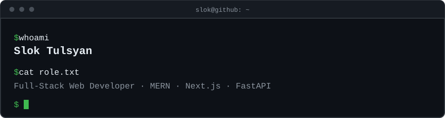
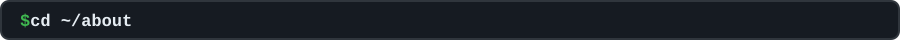
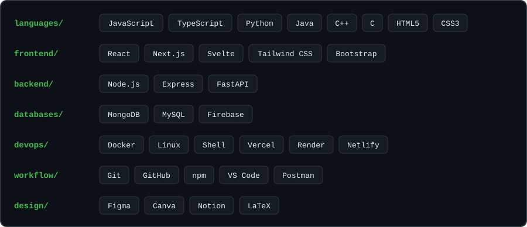
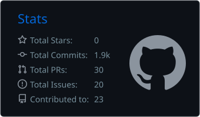
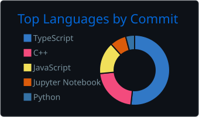
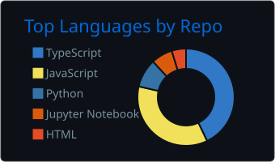
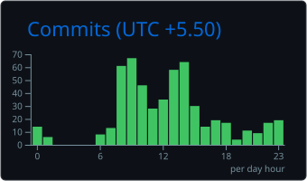
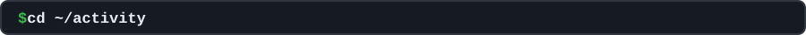
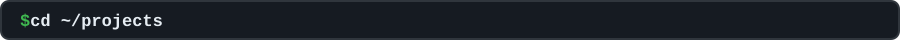

<p align="center">
  <a href="https://www.linkedin.com/in/slok-tulsyan-003786293/"></a>
  <a href="mailto:sloktulsyan@gmail.com"></a>
  <a href="https://stackoverflow.com/users/30654459"></a>
  <a href="https://instagram.com/tulsyanslok"></a>
</p>



```yaml
name:      Slok Tulsyan
role:      Full-Stack Web Developer
location:  Durg, Chhattisgarh, India
focus:     MERN · Next.js · FastAPI
open_to:   collaborations · hackathons · side projects
contact:   sloktulsyan@gmail.com
```





<p align="center">
  
  
</p>
<p align="center">
  
  
</p>
<p align="center">
  
</p>



<p align="center">
  <picture>
    <source media="(prefers-color-scheme: dark)" srcset="https://raw.githubusercontent.com/Slok9931/Slok9931/output/github-contribution-grid-snake-dark.svg" />
    <source media="(prefers-color-scheme: light)" srcset="https://raw.githubusercontent.com/Slok9931/Slok9931/output/github-contribution-grid-snake.svg" />
    
  </picture>
</p>



<!-- ✏️ Replace these rows with your real projects -->
| Project | Description | Stack |
| :--- | :--- | :--- |
| [project-one](https://github.com/Slok9931) | One line about what it does | React · Node.js · MongoDB |
| [project-two](https://github.com/Slok9931) | One line about what it does | Next.js · FastAPI |
| [project-three](https://github.com/Slok9931) | One line about what it does | Svelte · Firebase |

<br/>


